<picture>
  <source media="(prefers-color-scheme: dark)" srcset="docs/media/hero-dark.svg">
  
</picture>

# Agentroid

**The most phone control for the fewest tokens.** Agentroid is an MCP server (the Model Context Protocol is how tools plug into AI agents such as Claude Code) that lets an agent read and drive an Android phone or emulator over adb. Everything the agent reads stays in its context window, so a smaller screen means a cheaper step and room for a longer task. On a real home screen the raw dump is 30,910 characters; Agentroid's full listing of it is 2,550, and by default the agent gets a digest of the first 400 characters plus a one-line note on how to ask for more. All 27 tools fit in under 5,000 tokens.

 

> **Preview 0.1.0.** It works and is tested, but it is not 1.0. In this build the daemon runs on Windows only, and out of the box it drives emulators, not physical phones. See [Status](#status).

## Context budget

Every figure below comes from a test, a script or a recording in this repository. Screens are measured in characters and the tool list in tokens. These are sizes of one screen and of the tool list, not tokens per task: the [AndroidWorld benchmark](docs/BENCHMARK.md) in progress measures task success, not tokens.

| What | Measured | Where it is checked |
| --- | --- | --- |
| Tools | **27** (8 in the `minimal` profile) | [`apps/mcp/src/tools.ts`](apps/mcp/src/tools.ts), [`budget.test.ts`](apps/mcp/test/budget.test.ts) |
| The whole tool list | **under 5,000 tokens** | [`budget.test.ts`](apps/mcp/test/budget.test.ts) fails above it (today: 4,996, estimated as characters ÷ 3.2; this counts the tool list, not the server's 3,487-character instructions text) |
| The `minimal` tool list | **under 1,500 tokens** | same test (today: 1,497 on the same estimate) |
| A screen, by default | **400 characters at most**, plus a one-line note saying how to ask for more | `TEXT_LIMIT` in [`server-core.ts`](apps/mcp/src/server-core.ts), tested in [`server.test.ts`](apps/mcp/test/server.test.ts) ("response levels") |
| A screen diff, `ui_tree since=` | **7.2%** of a full read, for a one-row scroll of a generated 30-row list | [`crates/core/src/refs.rs`](crates/core/src/refs.rs), `a_since_diff_of_a_one_row_scroll_…` (the test fails above 30%) |
| Stable refs | **100%** kept across 200 generated re-layouts of a test list (3,078 of 3,078 checks) | [`crates/core/src/refs.rs`](crates/core/src/refs.rs), `the_same_row_keeps_its_ref_across_200_…` (the test fails below 95%) |
| Model tokens the server spends per call | **0**: it makes no model calls | every receipt reports `model_calls: 0`, `tokens_in: 0`, `tokens_out: 0` ([`receipt.ts`](apps/mcp/src/receipt.ts)) |
| Taps in one call | **6**, as one `job_start` | recorded on a phone: [the clip below](#real-output) |

**How to reproduce.** Run `npm test` in `apps/mcp`; the budget test prints `budget: full 4996 tok (27 tools), minimal 1497 tok (8 tools)`. A script for the exact count from Anthropic's `count_tokens` endpoint is written (`npm run budget:ci`, needs an API key) but does not run in CI yet. Run `cargo test -p agentroid-core --lib refs::tests -- --nocapture`; it prints `stable refs: kept 3078 of 3078 = 100.0%` and `since diff: 430 of 5953 chars = 7.2%`.

## How it saves tokens

- **A digest by default.** Every read answers at level `digest` unless the agent asks for more: the text is cut at 400 characters and ends with a note that names the next level up, `default` (4,000 characters) or `full` (everything). The agent pays for detail only when it needs it.
- **Diffs with `since=`.** Each tree names its snapshot (`s4`). `ui_tree(since="s4")` returns only the lines that were added (`+`), changed (`~`) or removed (`-`). An element that only moved on screen is left out, so a scroll costs a few lines, not a new screen.
- **Stable refs.** Each tappable line ends in a ref such as `r2bb170`, a hash of what the element is (class, id, label, its row in a list), never of where it sits (the content-identity scheme MobileMCP uses, plus the row's first label so repeated list rows keep theirs). After a scroll the agent taps the same ref instead of reading the screen again to find the new index.
- **Batched steps.** `job_start` runs a list of steps, or a YAML flow, on the daemon. Six taps cost one call and one reply rather than six model round trips.
- **No model calls in the server.** The calling agent is the brain. The MCP server and the Rust daemon make no model calls and need no model API key.
- **A small tool list, and a smaller one on request.** Start the server with `AGENTROID_PROFILE=minimal` for 8 tools (`list_devices`, `look`, `ui_tree`, `tap`, `type_text`, `key`, `getprop`, `doctor`) in under 1,500 tokens.

## Real output

One real screen: the home screen of a Xiaomi POCO X6 Pro (Android 15, HyperOS 2.0), recorded with `uiautomator dump` on 20 Oct 2026 ([the dump](crates/core/tests/redteam/recorded/poco-launcher-2026-10-20.xml)). The text below is what Agentroid's own parser and listing code produce from it; to fit side by side, long lines are wrapped at 40 characters (the digest's continuation lines are indented two spaces).

<table>
<tr>
<th width="50%">What the agent gets by default<br><code>ui_tree</code>, level <code>digest</code>: <b>453 characters</b></th>
<th width="50%">What it would read without Agentroid<br>the raw dump: <b>30,910 characters</b></th>
</tr>
<tr>
<td valign="top">

```text
[0] ScreenView "Clock / 1:07 / Tuesday, 
  20 Oct" [label from child] id=workspac
  e scrollable @(610,1332) rccbccd
[1] FrameLayout "Clock" clickable,long-c
  lickable @(610,476) r2bb170
[2] FrameLayout "1:07 / Tuesday, 20 Oct 
  / No data" [label from child] clickabl
  e @(610,476) r37be77
[3] View "1:07 / Tuesday, 20 Oct / No da
  ta" [label from child] clickable @(610
  ,476) r941e62
[4] View "1:07" @(324,275)
[5]
[cut: 2150 more characters; ask for leve
  l "default"]
```

</td>
<td valign="top">

```text
<?xml version='1.0' encoding='UTF-8' sta
ndalone='yes' ?><hierarchy rotation="0">
<node index="0" text="" resource-id="" c
lass="android.widget.FrameLayout" packag
e="com.mi.android.globallauncher" conten
t-desc="" checkable="false" checked="fal
se" clickable="false" enabled="true" foc
usable="false" focused="false" scrollabl
e="false" long-clickable="false" passwor
d="false" selected="false" bounds="[0,0]
[1220,2712]"><node index="0" text="" res
ource-id="" class="android.widget.Linear
Layout" package="com.mi.android.globalla
uncher" content-desc="" checkable="false
… 30,910 characters in all, on one line
```

</td>
</tr>
</table>

<details>
<summary>The full <code>ui_tree</code> listing of the same screen: 2,550 characters, 33 elements</summary>

```text
[0] ScreenView "Clock / 1:07 / Tuesday, 20 Oct" [label from child] id=workspace scrollable @(610,1332) rccbccd
[1] FrameLayout "Clock" clickable,long-clickable @(610,476) r2bb170
[2] FrameLayout "1:07 / Tuesday, 20 Oct / No data" [label from child] clickable @(610,476) r37be77
[3] View "1:07 / Tuesday, 20 Oct / No data" [label from child] clickable @(610,476) r941e62
[4] View "1:07" @(324,275)
[5] View "Tuesday, 20 Oct" @(344,395)
[6] View "No data" @(946,335)
[7] RelativeLayout "Search / Google Search / Google app" [label from child] long-clickable @(610,1191) r2645e5
[8] AppWidgetHostView "Search" @(610,1166)
[9] FrameLayout "googleapp_search_widget_ghost_google_logo" clickable @(163,1166) re1ea72
[10] FrameLayout "googleapp_search_widget_ghost_text_search" clickable @(538,1166) rc125ac
[11] FrameLayout "googleapp_search_widget_ghost_voice_search" clickable @(913,1166) ra06a82
[12] FrameLayout "googleapp_search_widget_ghost_lens" clickable @(1057,1166) re6519e
[13] ImageView "Google Search" id=googleapp_search_widget_background clickable @(610,1166) r0dc6ef
[14] ImageButton "Google app" id=googleapp_search_widget_google_logo clickable @(163,1166) ra75aca
[15] ImageButton "Voice search" id=googleapp_search_widget_voice_btn clickable @(913,1166) r51c012
[16] ImageButton "Camera search" id=googleapp_search_widget_lens_btn clickable @(1057,1166) r7dc530
[17] TextView "Gallery" clickable,long-clickable @(181,1477) r1f043e
[18] RelativeLayout "Google" clickable,long-clickable @(467,1477) r33578d
[19] ImageView "Google" id=icon_icon @(467,1447)
[20] TextView "Google" id=icon_title @(467,1583)
[21] TextView "Play Store" clickable,long-clickable @(753,1477) rd47592
[22] TextView "Themes" clickable,long-clickable @(1039,1477) rda65b2
[23] TextView "Security" desc="1 unread from Security" clickable,long-clickable @(181,1763) r557e2b
[24] TextView "Settings" desc="1 unread from Settings" clickable,long-clickable @(467,1763) r352116
[25] TextView "Cleaner" clickable,long-clickable @(753,1763) r653a51
[26] SeekBar "Page 1. Total pages: 2" scrollable @(610,2260) rff2766
[27] ImageView "Open App drawer" clickable @(610,2260) r2b26e6
[28] ScreenView "Phone / Messages / Chrome" [label from child] id=hotseat_content_screen scrollable @(610,2472) r25bfbd
[29] TextView "Phone" clickable,long-clickable @(181,2472) rf642c8
[30] TextView "Messages" clickable,long-clickable @(467,2472) rd7243f
[31] TextView "Chrome" clickable,long-clickable @(753,2472) r9ff1f0
[32] TextView "Camera" clickable,long-clickable @(1039,2472) r22466f
```

</details>

| The same screen as | Characters | Share of the raw dump |
| --- | ---: | ---: |
| Raw `uiautomator dump` | 30,910 | 100% |
| `ui_tree`, level `full` | 2,550 | 8.2% |
| `ui_tree`, `interactive_only` | 2,310 | 7.5% |
| `ui_tree`, level `digest` (the default) | 453 | 1.5% |
| `ui_tree since=`, read again with nothing changed | 65 | 0.2% |

Reproduce: `cargo run -p agentroid-core --example readme_tree_sizes` ([source](crates/core/examples/readme_tree_sizes.rs)). The counts are for the listing alone, without the one-line header the daemon puts above it. The digest is 400 characters of listing plus the 53-character note. On this screen those 400 characters hold only the clock widget, not the app icons, so an agent looking for Settings would ask for level `default` and get the whole 2,550-character listing; that is still 8.2% of the raw dump.


*Six taps in one call: `job_start` in sync mode runs six steps on the phone and returns one row per step plus a receipt. The run took 49 s on the phone, most of it reading the screen between taps; the clip plays at 4x. A short script acted as the MCP client for this recording, so Claude Code was not in the loop.*

## Install and quick start

**You need:** Windows 10 or 11 (the daemon uses a named pipe and refuses to start elsewhere), `adb` from the Android platform-tools, a recent stable Rust toolchain (built with 1.99.0) with the Visual Studio C++ Build Tools, Node.js 22.6 or later, and Claude Code. Full requirements and troubleshooting are in [docs/REFERENCE.md](docs/REFERENCE.md#setup-notes).

From the repository root, in PowerShell:

```powershell
git clone https://github.com/Sohwhat6420/agentroid-mcp.git
cd agentroid-mcp
cargo build --release --workspace

# Start an emulator, then check that adb lists it as "device".
adb devices -l

# Start the daemon. It has no console window, so the command returns at once.
.\target\release\bridged.exe --adb auto --allow-emulators

# Install the MCP server and register it with Claude Code.
cd apps\mcp
npm ci
claude mcp add agentroid -- node --experimental-strip-types "<full path to>\agentroid-mcp\apps\mcp\src\sdk-wiring.ts"
```

Then ask your agent something like: *"Use Agentroid to look at the screen and tell me what is on it."*

- **A physical phone** is driven only once you name it: start the daemon with `--allow-serial <serial>` (the serial is `adb shell getprop ro.serialno`).
- **The smaller tool list:** set `AGENTROID_PROFILE=minimal` in the server's environment.
- **Stop the daemon** with `.\target\release\bridged.exe --stop`. If it does not start, the log is at `%LOCALAPPDATA%\agentroid\bridged.log`.

Use it on devices you own or are allowed to test. A screen guard in the daemon refuses the payments, factory resets and credential entry it recognises; its known misses are published in [docs/SAFETY.md](docs/SAFETY.md).

## Status

Agentroid is a preview (0.1.0), released for trial and demo; nothing is published to crates.io or npm.

- **Tested on** an Android 13 emulator and one physical phone (Xiaomi POCO X6 Pro, Android 15, HyperOS 2.0), with Claude Code as the only MCP client tried.
- **Windows only** for the daemon in this build. A Linux listener is written but not yet built or tested.
- **Text, not pictures:** `screenshot` and `look` do not send image bytes to the agent in this build.
- **Not implemented yet:** `pixel_probe`, and `look`'s `element` and `ocr` options. `set_value` sets text fields only.
- **The AndroidWorld benchmark** is in progress: [docs/BENCHMARK.md](docs/BENCHMARK.md) shows what has been measured so far.

## More

- [docs/REFERENCE.md](docs/REFERENCE.md): every feature, the full setup notes, troubleshooting and the full project status.
- [docs/SAFETY.md](docs/SAFETY.md): how the daemon's screen guard decides, and its published red-team results.
- [docs/BENCHMARK.md](docs/BENCHMARK.md): the AndroidWorld runs so far.
- [docs/CONNECTION-KEEPER.md](docs/CONNECTION-KEEPER.md): the Android module that brings wireless adb back after a Wi-Fi drop or a reboot.
- [docs/media/src](docs/media/src): the script that draws the card at the top of this page and the social banner from the measured output.

## Contributing

See [CONTRIBUTING.md](CONTRIBUTING.md).

## Licence

Apache License 2.0. See [LICENSE](LICENSE) and [NOTICE](NOTICE). Android is a trade mark of Google LLC; this project is not affiliated with Google.
