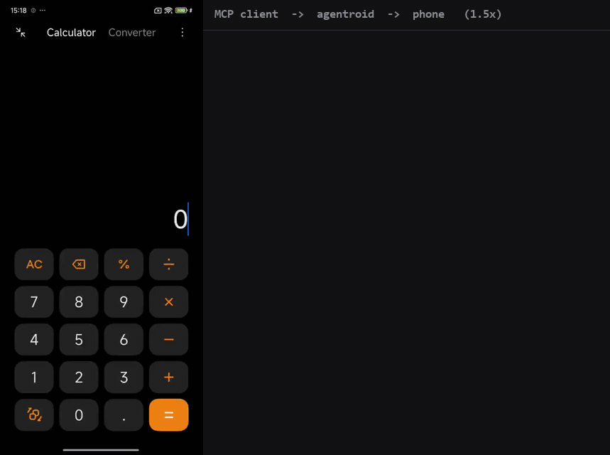
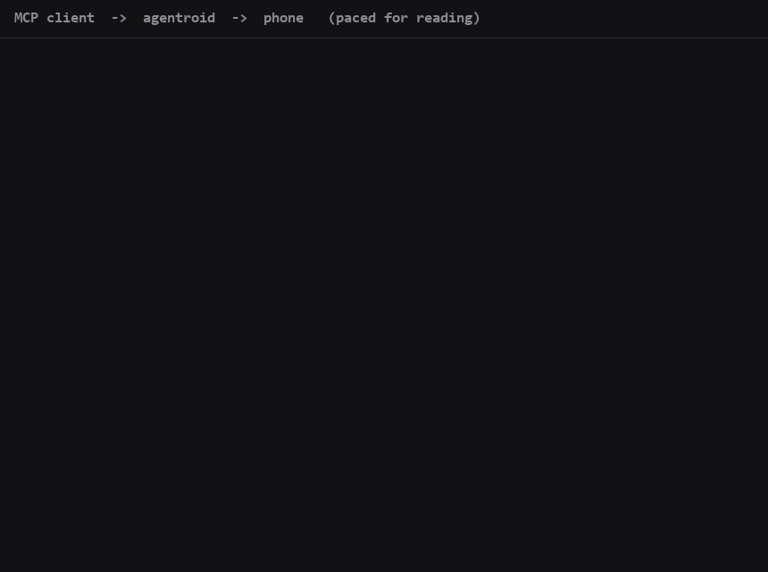
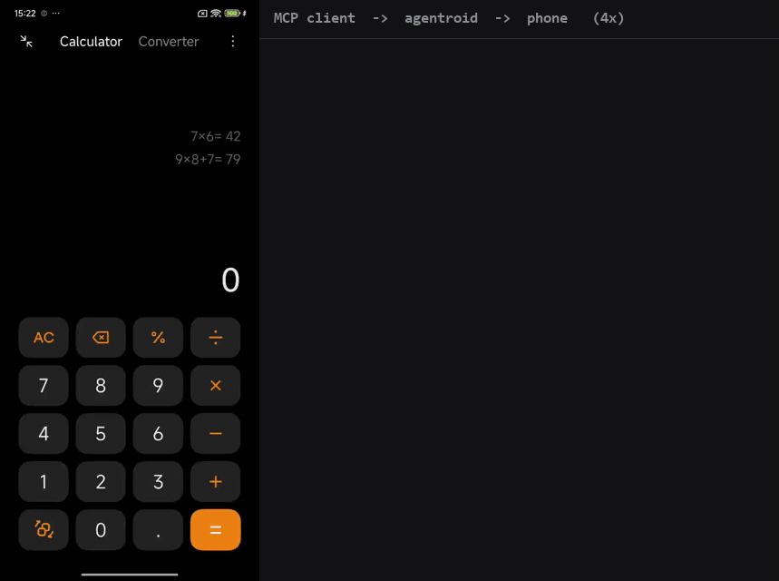

# Agentroid

 

Agentroid lets an AI agent that speaks MCP, such as Claude Code, look at and operate an Android phone or emulator over adb. The MCP server makes no model calls, so it needs no model API key, and the safety checks run in a Rust daemon rather than in a prompt.

It is meant for developers and testers who want an agent to drive an Android device, and for people with spare or test phones.

> **Preview: a trial and demo release.** It works and is tested, but it is not 1.0, and the benchmark run is still in progress ([Benchmark](#benchmark) shows only what has been measured so far). Read [Project status](#project-status) before you try it. In this build the daemon is Windows-only, and out of the box it will drive emulators, not physical phones.

## The parts

| | What it is | Evidence today |
| --- | --- | --- |
| **1. An agent drives a phone** | Claude Code reads the screen as a numbered UI tree and taps, types and scrolls on an emulator or an allowed phone, through 27 MCP tools. | Works. Exercised on an Android 13 emulator and on one physical phone (Xiaomi POCO X6 Pro, Android 15, HyperOS 2.0). See [Demo](#demo). |
| **2. A benchmark score card** | The same loop run against AndroidWorld's 116 tasks on an emulator, scored by AndroidWorld itself. | **In progress.** Measured so far (11 Nov 2026): 16 of 20 passed on a 20-task pilot with every safety refusal kept (no stand-in approver). A partial full run that has reached 16 of the 116 tasks passed 6 with the emulator-only stand-in approver, or 5 counting only tasks that needed no approval; the guard asked for approval once. See [Benchmark in progress](#benchmark-in-progress). An earlier run with a different policy passed 61 of the 116 tasks (52.6%); its result files are not in this repository, so treat it as unverified. |
| **3. The connection keeper** | An Android module (`android/keeper`) that turns Wireless debugging back on after a Wi-Fi drop, a crash or a reboot, so the adb link to the phone returns with no tap. | Measured on one phone: after Wi-Fi was switched off for 10 s, the adb link was back 12 to 13 s later in 3 of 3 rounds, with no tap; it also came back after a process crash and after a cold boot, before the first unlock. This is not yet tested against a real router outage. The standalone build is documented in [apps/keeper](apps/keeper) (no Gradle, 40 logic tests in CI). Limits in [The connection keeper](#the-connection-keeper). |
| **4. The phone helps the laptop** | Sharing local AI work between laptop and phone: one model split across both, or the phone running speech and vision while the laptop answers. | **PENDING.** Designed, not built or measured. It is listed because it is part of the project; no number is claimed. |
| **5. A screen guard with a public red-team** | Before any tap, swipe, keystroke or link, the daemon reads the screen and refuses payments, transfers, factory resets, credential entry and security-setting changes, whatever the model was told. Every decision goes into a hash-chained audit log. | 44 of 44 hostile test cases refused or held, 12 of 12 ordinary actions still allowed, 4 known misses published (a fifth is now partly caught). Four blind rounds written by agents that never saw the rules scored **11 of 20** (13 after a test-runner selector fix), **12, 12 and 18 of 20** before their misses were fixed. See [docs/SAFETY.md](docs/SAFETY.md). |

**Only tested with Claude Code.** Claude Code is the only MCP client Agentroid has been tried with; nothing is claimed for any other client.

## What it does

- **27 MCP tools.** 23 device tools (reads and actions) and 4 job tools. You can read the screen as a numbered UI tree (`ui_tree`, `look`), tap, long-press, swipe, scroll, type, press keys, unlock, open apps, URLs and activities, list installed apps, read system properties, run read-only diagnostics (`doctor`), and copy files to and from the phone (`push`, `pull_new`). Not everything is finished: `pixel_probe` and `look`'s `element` and `ocr` options are not implemented in this build and always return an error, and `set_value` sets text fields only.
- **Stable refs.** Each interactive line of a UI tree ends in a short ref that stays the same for the same element after a scroll or re-layout, unlike its index. `ui_tree` can return only what changed since an earlier snapshot.
- **Plain adb.** The live transport reads the screen with `uiautomator dump` and acts with `adb shell input`. No app has to be installed on the phone.
- **Text, not pictures.** `screenshot` and `look` capture the screen on your machine, but this build does not send image bytes back to the agent; it works from the text tree.
- **Uses the calling agent as the brain.** The MCP server and the daemon make no model calls, so each result reports 0 tokens and 0 cost for the bridge itself.
- **More than one phone, one session each.** A phone is leased to one session at a time, and a second session is refused with the holder's name. When several devices are connected and a call names none, the MCP server refuses instead of choosing.
- **The screen stays on while you work.** On a `full` phone, a session's first call raises the screen timeout to 30 minutes and turns on stay-awake while plugged in. Your own values come back when the last session disconnects, after 15 minutes with no call, or when the daemon stops; a value you changed meanwhile is left alone. Both changes are written to `leases.json` first, so after a crash the next daemon puts them back. Lock, PIN and password settings are never touched. Emulators are skipped, and so are `read_only` phones, except the one hardcoded protected phone, which gets these two settings and nothing else (see [docs/SAFETY.md](docs/SAFETY.md)). The hold runs in the background, so no call waits for it. `AGENTROID_NO_STAY_AWAKE=1` turns it off.
- **Jobs on the daemon.** `job_start` runs a YAML flow, or a short list of steps in one app, on the daemon so that each step does not cost a model round trip. Steps are written to a journal before they are sent, a job can be paused, stopped and resumed, and a finished run can be saved as a replayable flow (`record`), with an export to Maestro commands.
- **An optional helper app.** The `android/` folder holds an Android helper (accessibility service, input method, link service). It is built and unit-tested, but this build's live transport has no link to it yet, so no tool needs it today. See [Quick start](#quick-start).
- **No telemetry.** Nothing is sent to the project or to any analytics service. There are three optional outbound paths, all to [ntfy](https://ntfy.sh), and all are off until you set them up:
  - **Job pushes.** If you create `%USERPROFILE%\.agentroid\ntfy-topic.txt` (one line: a private topic name), the MCP server posts a short push when a job becomes stuck or done. It carries the run id, the flow name and step counts, not screen content. Set `AGENTROID_NO_PUSH=1` to turn it off.
  - **Approval requests.** If you start the daemon with `--approval-topic-file <file>`, every `asked` action posts an approval request to that topic and waits for your Allow or Deny. The request carries the tool, the phone's **hardware serial**, the guard's reason (which quotes the matched on-screen label, such as `"Delete"`) and the target label. The default server is `https://ntfy.sh`; `--ntfy-base <url>` points it at your own. `AGENTROID_NO_PUSH` does not affect this path.
  - **Screen take-over asks (INTERIM).** `agentroid ask-screen --route <file>` posts one Yes / No push when a session wants a phone that is in use. It carries the label you pass with `--name` (not the serial), the minutes asked for, the session's reason and what made the phone count as in use (for example `com.whatsapp is open`). See [Ask before taking over a screen](#ask-before-taking-over-a-screen-interim).

  Treat the topic names as secrets, and prefer a self-hosted ntfy server.

## Safety model

The checks live in the daemon (`bridged`), not in a prompt. They run on every call after the model has asked and before anything reaches adb, so a confused or prompt-injected model cannot argue its way past them. They bound what an agent can do. They cannot tell whether a particular tap is a good idea.

- **Device allowlist.** Nothing is driven by default. The daemon refuses any call aimed at a device whose hardware serial you have not named, with `--allow-serial <serial>` (repeatable), a line in `allow.txt` in its state directory, or `--allow-file <path>`. Emulators are admitted only with `--allow-emulators`.
- **Deny-by-default adb guard.** Every adb command the daemon sends passes through a guard. It refuses adb subcommands it does not know, always refuses `kill-server`, `start-server`, `keygen`, `pair` and `reconnect`, requires an explicit target for per-device commands, requires `connect` and `disconnect` to name exactly one address, and reads the real hardware serial behind a target before it lets a command out. The guard works at the level of adb subcommands, so on its own it does not restrict what a `shell` command contains. That restriction comes from the tool layer, next.
- **No free shell.** None of the 27 tools takes a raw shell command. `doctor`, and the `agentroid.shell` function available inside `run_script`, accept only complete command patterns for read-only diagnostics, refuse any shell metacharacter or quote, and refuse everything else. `run_script` runs JavaScript in QuickJS in a child process under a Windows Job Object (64 MB memory limit, CPU deadline, no `eval`, no file or network access). `push` copies a file from your machine to the phone and is allowed on `full` devices only. Both sides are fenced: on the phone, shared storage only; on the laptop, `push` reads only from `%LOCALAPPDATA%\agentroid\files\outbox` and `pull_new` writes only to `...\files\inbox`. Copy a file into the outbox before you ask for it to be pushed.
- **Device modes.** The gate knows three modes. `full` allows everything. `helper` allows only gestures, keys and typing. `read_only` refuses every call that changes anything and answers reads only. The HTTP listener enforces a mode per access token. On the plain stdio path there is no setting for a mode yet, so every allowed device runs as `full`.
- **Screen guard.** Every acting call (tap, long-press, swipe, type, key, open an app, a URL or an activity, unlock) is checked against what is on the screen at that moment. It gets one of three verdicts. `allowed` runs. `blocked` does not run: payments and checkout, banking apps, factory reset, typing into password or one-time-code fields, card numbers, device-admin and accessibility grants, and turning on "install unknown apps" for a source. `asked` covers send, delete, install, uninstall and permission dialogs: with the approval channel on (`--approval-topic-file`, see [Turn on approvals](#quick-start)), you get a push with Allow and Deny buttons and have 90 seconds to answer, otherwise the call is refused; with no channel set up it is refused at once. The agent waits 100 seconds for the call, so it is still waiting while your Allow can run. Do not install the ntfy app on the phone being driven, because its Allow button would be on the agent's own screen. Cancel, Back, Close and Navigate up are always allowed. The guard is plain Rust rules with no model call, so prompt injection on the screen cannot argue with it, and it reads the screen again if the stored copy is more than 2 seconds old. It reads text, descriptions and ids in 16 languages (plus Tagalog payment words), folds look-alike letters, and checks taps by coordinate as well as by name. Known misses: buttons drawn inside games, icon-only buttons with no label, a one-time code typed into an ordinary chat box that never mentions a code, and a pop-up inside the 2-second window. The full list is in [docs/SAFETY.md](docs/SAFETY.md). To keep an agent away from money or account data altogether, still prefer an emulator, a phone with no payment methods signed in, or a `read_only` device.
- **Tamper-evident audit log.** Each decision, allowed or refused, is a JSON line chained to the one before it by SHA-256. It is written before the action is sent, and an action is refused if the log cannot be written. `agentroid audit verify <log>` reports an edited line, a re-hashed edit or lines cut off the end. It rotates every 10,000 records or 7 days, and `--audit-anchor <path>` writes the chain head to a second place (ideally off the machine), which catches a log rewritten from scratch (best effort by default; `--audit-anchor-required` refuses the action if the anchor cannot be written).
- **Shell and files.** Raw shell lines from `run_script` and `push`/`pull_new` go through the same gate and log: wiping, security-setting, credential-store and input-injection commands are refused outright, and in this build every other line that is not on the read-only list is refused too. Pushes and pulls are limited to shared storage on the phone.
- **Flow risk labels.** Flow steps still carry a risk label (R0 to R5), and a flow with any step rated R2 or higher is refused before its first step. The label is written by the flow's author, which may be the agent, so the screen guard on every step is the real control. A permission pop-up, an unknown overlay or a `checkpoint` step pauses the job for a person.
- **Screen lock.** On a real phone, every call that changes the screen (tap, long-press, swipe, scroll, type, key, unlock, open an app, a URL or an activity, the acting steps of flows and jobs, link segments, and every `run_script` shell line that is not on the read-only list) is refused unless `agentroid ask-screen` gave a lease that is still live, or the phone is not in use at the moment of the call. See [The screen lock](#the-screen-lock). Emulators are not locked.
- **Lock screen.** `unlock` wakes the screen and swipes away a swipe-only lock screen. If a PIN, pattern or password is set, it reports that the phone is still locked and stops.
- **Journal and receipts.** The intent of every acting step is written to the run journal and flushed to disk before the step is sent, and every tool result carries a receipt (calls, wall time, retries, errors). A refusal returns its reason to the caller. The run journal itself is an ordinary append-only file; the tamper-evident record of every guard decision is the audit log above.
- **Local access.** The daemon listens on a Windows named pipe that admits only the current user, rejects remote clients, and will not start if another process already owns the name. Any process running as your Windows user can still talk to it.
- **Remote access (optional).** The HTTP listener binds one literal address, either your tailnet IPv4 (100.64.0.0/10) or 127.0.0.1, and refuses 0.0.0.0, LAN addresses and host names. Each bearer token is limited to one device and one mode and is stored in Windows Credential Manager. The helper app's phone link dials out to the laptop on the tailnet, and the helper opens no listening socket. The link authenticates both ends with P-256 signatures but Agentroid does not encrypt it, so it depends on the private network underneath. This path has been tested against fakes and not yet end to end on a real phone.

See [SECURITY.md](SECURITY.md) to report a vulnerability.

### Responsible use

Use Agentroid on devices you own or are authorised to test. It does not bypass a PIN, pattern or password lock screen. It is not built to defeat app protections or to run fake accounts, and contributions for that will not be accepted. This is a project rule, not something the code enforces.

## Quick start

**Requirements**

- Windows 10 or 11. The daemon uses a named pipe and Windows APIs and refuses to start elsewhere. Tested on Windows 11 Home (build 10.0.26200); Windows 10 has not been tried.
- `adb` from the Android platform-tools. `bridged --adb auto` looks for scrcpy's `adb`, then `ANDROID_HOME` or `ANDROID_SDK_ROOT`, then `%LOCALAPPDATA%\Android\Sdk`, then `adb` on `PATH`. Tested with adb 1.0.41 (platform-tools 37.0.0 from scrcpy 4.1 and 37.0.1 from the SDK); no older version has been tried, so no minimum is claimed.
- A recent stable Rust toolchain. The lock file is format 4, and the project was built with Rust 1.99.0. No older toolchain has been tried and `Cargo.toml` declares no `rust-version`.
- Node.js 22.6 or later. The MCP server runs its TypeScript directly with `node --experimental-strip-types`, which older versions do not have. It was developed on Node 22.17.0.
- The Visual Studio C++ Build Tools (the "Desktop development with C++" workload). The MSVC Rust toolchain needs them, and the `run_script` sandbox compiles QuickJS from C.
- `curl` on `PATH` (Windows 10 and 11 include it), used by the approval channel.
- The `claude` command-line tool, to register the MCP server.
- An MCP client. The commands below use Claude Code, the only client tested.
- An Android emulator, or a physical phone whose hardware serial you allow (see the note after the commands). The helper app, if you build it, targets Android 10 (API 29) and later. The lowest Android version for the adb-only path has not been established; it was run on Android 13 (emulator) and Android 15 (phone).

**Install and run** (PowerShell, from the repository root)

```powershell
git clone https://github.com/Sohwhat6420/agentroid-mcp.git
cd agentroid-mcp
cargo build --release --workspace

# Start an emulator or connect a phone, then check that adb lists it as "device".
adb devices -l

# Start the daemon. It has no console window, so the command returns at once.
.\target\release\bridged.exe --adb auto --allow-emulators

# Check that it started: the log should end with a "listening on" line.
Get-Content "$env:LOCALAPPDATA\agentroid\bridged.log" -Tail 5

# Install the MCP server and register it with Claude Code.
cd apps\mcp
npm ci
claude mcp add agentroid -- node --experimental-strip-types "<full path to>\agentroid\apps\mcp\src\sdk-wiring.ts"
```

To stop the daemon: `.\target\release\bridged.exe --stop`.

**If the daemon does not start.** Because it has no console, a mistyped flag (for example `--allow-emulator` without the `s`) makes it exit at once and leaves no trace, not even in `bridged.log`. If no new `listening on` line appears, check each flag against the list at the top of `crates/bridged/src/main.rs`.

**Turn on approvals (optional).** Without them every `asked` action (send, delete, uninstall, a permission) is refused. Put a private, hard-to-guess ntfy topic name on one line of a file, for example `%LOCALAPPDATA%\agentroid\ntfy-topic.key`, subscribe to that topic in the ntfy app on a phone or browser that the agent is not driving, and start the daemon with `--approval-topic-file <that file>` (add `--ntfy-base <url>` for your own ntfy server). Each request carries the tool, the phone's hardware serial and the matched on-screen label (see [What it does](#what-it-does)).

Then ask your agent something like: *"Use Agentroid to list the connected devices, look at the screen, and tell me what is on it."*

Nothing is driven until you name it. For an emulator start the daemon with `--allow-emulators`. For a physical phone find its hardware serial (`adb shell getprop ro.serialno`) and start it with `--allow-serial <that serial>`, or put the serial on a line of `allow.txt` in the daemon's state directory (`#` starts a comment; UTF-8 or UTF-16 text). Entries are hardware serials of 6 to 64 letters and digits, matched ignoring case; addresses and fragments are refused. A bad or unreadable allow file stops the daemon rather than being ignored. The default state directory is `%LOCALAPPDATA%\agentroid`.

**Check a phone (read-only)**

```powershell
.\target\release\agentroid-setup.exe doctor --device <adb serial>
```

`doctor` reads settings from the phone and prints the exact fix for each problem it finds. `agentroid-setup` looks for `adb` on your `PATH` unless you pass `--adb <path>`. `agentroid-setup --dry-run` prints what `setup` would change without writing anything, and `agentroid-setup --undo` reverts a setup run. `setup` records a device profile and a `devices.toml` entry; the daemon does not read `devices.toml` yet.

**Which parts need the helper app?** None of the tools in this build. Everything above runs over plain adb. The helper (intended for accessibility-based tree reads, non-ASCII typing and the phone link) is not connected to the live transport yet, so non-ASCII text typing answers that the helper is not installed. If you want to build it anyway, the route that has been run is `android/build-helper.sh` (JDK 17 and the Android SDK, no Gradle); it reads three library jars from a folder you name with `HELPER_LIBS`. The CI job `android-helper` builds it on every push: it fetches the jars from Maven Central, checks their SHA-256s and uploads the debug APK, so copy that job's steps to build it yourself. The Gradle build (`./gradlew assembleHelperDebug testDebugUnitTest`) also works: it was run once by hand (25 Oct 2026) and produced the debug APK, but CI does not run it. Either way the result is a debug build to sideload with `adb install`, not a release, and neither route builds the connection keeper: that has its own build in [apps/keeper](apps/keeper).

**Troubleshooting**

- *The phone is not listed, or is `unauthorized`.* Turn on USB debugging in Developer options, accept the computer's key on the phone, and check `adb devices -l` shows `device`.
- *Wireless debugging.* Pair the phone yourself with adb in your own terminal. Agentroid's guard refuses `adb pair` by design.
- *Wireless connections drop when Agentroid starts.* An adb client of a different build from the running adb server restarts the server and drops wireless connections. `--adb auto` prefers scrcpy's adb for that reason, so run the same adb everywhere, or pass a path with `--adb`.
- *Another automation tool is running.* Only one UI-automation connection exists per phone. Stop uiautomator2, Appium or similar tools on the laptop; `agentroid-setup doctor` flags them.
- *The screen looks stale right after an action.* The new screen can take a second or more to reach the tree on an emulator. Read again, or use `wait`.
- *Xiaomi HyperOS.* `agentroid-setup`'s quirks list asks for Developer options > USB debugging (Security settings) and Install via USB, which need a SIM and a signed-in Mi account once, and for Autostart and battery "No restrictions" for the helper app. These quirks were recorded on one phone and not all re-measured.

## Benchmark

### Benchmark in progress

There is no full 116-task score yet. Everything below was measured, and each row gives its date and configuration. Nothing here is projected. Per-task result files are published with the full run; until then, treat these as the author's report.

**1. A 20-task pilot: which additions help** (11 Nov 2026; `bench/androidworld/subset-20.json`; Claude Opus 5.5 through `claude -p`; one attempt per task; Android 13 emulator on a Windows laptop; no stand-in approver, so the guard's refusals count as fails). Each addition was kept only if it beat the best score so far by its threshold. One run per stage, so a 1-task difference is close to noise.

| Stage | Adds | Passed of 20 | Kept |
| --- | --- | --- | --- |
| A0 | the base loop (policy v3, agent mode) | 15 | baseline |
| +screens | a screenshot with each turn | 16 | no (needed 17) |
| +planner | a separate planner | 14 | no |
| +verifier | a separate verifier must agree before "complete" | **16** | **yes** |
| +notes | a scratchpad, on top of the verifier | 15 | no |
| +stall | a re-plan after a stall, on top of the verifier | 15 | no |

**2. Run 2, the full task list with the verifier: partial** (11 Nov 2026; `subset-all.json` in order; the same model and laptop; the bench stand-in approver on). It was stopped for laptop memory after 16 of the 116 tasks.

| Tasks run | Passed (with approvals) | Passed (guarded: no approval needed) | Asks answered by the stand-in |
| --- | --- | --- | --- |
| 16 of 116 | 6 | 5 | 1 |

"Guarded" counts only tasks that passed without the guard asking for a human yes. On an emulator nobody can tap Allow, so the stand-in approver (`--bench-approve`, emulator only, audited as `approved:bench`) answers instead. Both numbers are reported, along with the count of asks. The approval counter in `run_pilot.py` was fixed at 20:15, before the second chunk, and the first chunk was recounted from its saved audit log.

**What comes next.** The rest of the benchmark runs on GitHub Actions emulators. Those runs are their own hardware configuration and are never added to the laptop numbers above. There will be two configurations: run 2 (verifier, the guard as it was) and run 3 (verifier and screens, with the stopwatch fix below), each on the full 116.

**A known limit the runs found.** The guard reads the screen with `uiautomator dump`, which waits for the screen to be still. On a screen that never stops changing, such as a running stopwatch, it gives up with "could not get idle state". The guard then cannot read the screen and refuses the tap: safe, but a lost task. On 11 Nov the stock dump read 0 of 3 times on the emulator with a stopwatch running. A small read-only fallback reader read 3 of 3. bridged now uses the fallback for that one error, and run 3 measures the change. Details are in [docs/SAFETY.md](docs/SAFETY.md).

**How it is run.** This is the *executor* setup. AndroidWorld's own harness sets each task up and scores it. Agentroid's agent loop (`bench/androidworld/run_pilot.py`) plays the task, with a Claude model as the policy.

- Policy v3 (`bench/androidworld/policy-v3/`): one warm `claude -p` session per task acts as the executor, with tools, settings and MCP servers switched off, so the model only answers. The switchable additions in the table above (verifier, screens and the others) are separate one-shot calls.
- At each step the model is given the task, its recent actions and AndroidWorld's numbered list of UI elements, and returns one action in AndroidWorld's `JSONAction` vocabulary (14 action types). Agentroid carries the action out through its MCP tools.
- The step budget per task is AndroidWorld's own: the task's complexity times 10.
- Success is AndroidWorld's own `is_successful` for the task, checked after the last step.
- The runs are on an Android emulator with a headless x86_64 Google APIs image (Android 13, API 33).
- The task list is `bench/androidworld/subset-all.json` (116 tasks, the complete AndroidWorld registry as of 28 Oct 2026: the names match exactly). Many tasks use AndroidWorld's own apps, which must be installed on the emulator first. A task that cannot be set up or scored is recorded as unscored. The headline rate is passed tasks out of all 116, so an unscored task counts against the score; the rate over scored tasks only is shown beside it.
- Model, number of attempts (one per task), date and the commit of this repository go in the table when the run is done.
- The policy used for the release run was written after reading the failures of an earlier run, so the result is not a held-out score: it measures a loop that was tuned on this same task list.
- Policy v3 calls the model through the `claude` CLI (`--backend claude-p`; `AGENTROID_CLAUDE` names another binary). The older policies call it through a dispatcher script you supply (`AGENTROID_DISPATCH`). The scripts in `bench/androidworld/` read the SDK, emulator and APK locations from environment variables (`ANDROID_SDK_ROOT`, `ANDROID_AVD_HOME`, `AW_APKS`, `AW_PYTHON`). For the older policies no dispatcher is included, so a run on another machine needs one written first. The offline tests run anywhere.

**Compare only like with like.** These results are not comparable with leaderboard entries that use a different agent loop or observation. An entry that uses a different agent loop, prompt or observation (AndroidWorld's own reference agents, M3A and T3A, are examples of agents with their own loop) measures something different. Here the loop, the prompt and the action executor are Agentroid's, and the model sees AndroidWorld's element list rather than Agentroid's own tree, so the number measures this loop with this model and this executor, not the model alone. Known differences from AndroidWorld's own executor, such as how a double tap, a text field clear and a scroll on element 0 are performed, are listed in `bench/androidworld/ACTION-SPACE.md`. A second mode, where the model calls Agentroid's tools directly, has had a smoke test only and has no results.

## The connection keeper

`android/keeper` is an Android module for a phone you leave connected over Wireless debugging. A standalone 25 KB build of the same keeper, with its own build and setup scripts, is in [apps/keeper](apps/keeper). adb over Wi-Fi switches itself off when the Wi-Fi drops, the phone reboots or the app that holds it is killed, and the next command then fails until someone taps the Wireless debugging tile. The keeper checks on a 15-minute alarm (Doze stretches that to about 20 minutes) and whenever the network is lost or comes back, and switches Wireless debugging back on. It also registers for the boot broadcast that runs before the first unlock, so a phone that restarts overnight comes back without a tap.

What it needs: a one-time `adb shell pm grant` of `WRITE_SECURE_SETTINGS` (only adb can give it), Wireless debugging switched on once, and, on Xiaomi HyperOS, Autostart and battery "No restrictions". Android asks "Allow wireless debugging on this network?" once for each Wi-Fi access point (BSSID); tick *Always allow* for each one you use, because the keeper cannot answer that prompt.

What was measured, all on one phone (Xiaomi POCO X6 Pro, Android 15, HyperOS 2.0) over wireless adb, with no USB cable at any point:

- *Wi-Fi switched off for 10 s, screen off, phone unplugged:* the adb link was back after 12, 12 and 13 s (3 of 3 rounds), with no tap. These used a fixed address (`adb tcpip 5555`); a recovery of the TLS port alone was not timed.
- *Process crash (`am crash`):* the keeper was running again after about 17 minutes, through its alarm.
- *Cold boot behind the lock screen* (the phone had shut down on a flat battery, and was restarted): Wireless debugging was switched on before the first unlock, and the laptop reconnected about three minutes later without a tap. This happened once, by accident, and was not repeated.
- *Not tested:* a real router outage, and a second access point (which needs its one prompt tapped).

Limits: on this phone the Wi-Fi itself sometimes took 4 to 30 minutes to rejoin after being switched off with the screen off and the phone unplugged, and the adb link came back about 40 s after the Wi-Fi did. The keeper cannot shorten that. A later version wakes the screen for a few seconds while the network is gone to speed the rejoin; it is installed but has not been seen to fire in a test, so no claim is made for it. A flat battery stops everything. The 5555 address does not survive a reboot (the keeper restores Wireless debugging, and the TLS entry reconnects, but `adb tcpip 5555` must be run again).

## Ask before taking over a screen (INTERIM)

> **INTERIM.** For now the Yes is a plain tap on a push button. A later version will ask for the owner's fingerprint (a passkey) before a Yes counts. Until then, anyone who can tap the push on the owner's phone can say Yes. The push title starts with `INTERIM` so this is never forgotten.

An agent that drives a phone someone is using takes the screen out of their hands. `agentroid ask-screen` is the one check to run first, whether the session then uses Agentroid's tools or raw adb:

```text
agentroid ask-screen --device <serial|ip:port> --minutes N --why "what and why" --session "who is asking" --route route.json
```

It prints one line of JSON and exits **0 (allowed)** or **1 (refused)**. Exit 2 is a usage error, and 3 means the phone could not be read.

- **In use** means the screen is on and any of these holds:
  - the focused app is one people type in: the Claude app (`com.anthropic.claude`), WhatsApp, Gmail, or any `--in-use-app <package>`;
  - the keyboard is open (`mInputShown` in `dumpsys input_method`);
  - the last touch was under `--idle-min` minutes ago (default 5; read from `dumpsys power`, which states it directly as the display group's `lastUserActivityTime ... ms ago`);
  - the screen is held on: a screen wake lock in `dumpsys power` (a video, or a reader that keeps the screen awake), or the proximity lock a call holds while the phone is at someone's ear.

  Anything it cannot read counts as in use, and so does any screen state other than Awake, Asleep, Dozing or Dreaming.
- **A call** that is ringing or live (`mCallState` in `dumpsys telephony.registry`, read whatever the screen shows) is in use, with the screen on or off. There is no carrier call only when every `mCallState` line (one per SIM) is idle, or the device has no telephony: the service does not exist (`Can't find service: telephony.registry`), or a finished registry dump (its `last known state:` header) has no phone slots, as on a tablet or an emulator without a radio. If the call state cannot be read, the phone counts as in use: the read fails or is refused, or the dump timed out (`DUMP TIMEOUT`), errored (`Error dumping`), was refused (`Permission Denial`), came back empty, or says nothing this rule knows. A ringing or live line counts as a call even in a dump that did not finish. A phone on the protected list answers only `dumpsys power`, plus, for this reader alone, its call state: since 14 Nov 2026, on its owner's yes, the screen lock's and `ask-screen`'s own reader may read its `dumpsys telephony.registry` and keeps only whether a call is on (see [docs/SAFETY.md](docs/SAFETY.md)). So it is asked whenever its screen is on (the app, keyboard and lock state cannot be read), and not when it is asleep with no call.
- **Not in use** (the screen is off or dozing; or on, untouched, with nothing holding it on, no keyboard and no listed app; and in both cases no call): allowed at once, with no push. Run the command again before each burst of actions.
- **In use:** one push with what the session wants and for about how long, with Allow and Deny buttons. Answer within `--wait-s` seconds (default 90, from 30 to 300). With the default it usually ends within about 100 s, but slow adb reads and polls can add up to about 45 s more, so give the command a tool timeout of at least `--wait-s` + 60 s (150 s with the default).
  - **Allow** gives a lease of 1.5 × N minutes (at most 60) to that session and purpose only: the same `--session` (default: the `--why` text) and the same `--why`. Calls inside the lease are allowed without another push. Another session, or the same one asking for something else, is asked about on its own.
  - **Deny, or no answer,** refuses. Every call for that phone in the next 5 minutes, from any session, is then refused without a push, even if the phone is put down meanwhile.
  - **One ask at a time:** while an ask is waiting on the owner, other calls for that phone are refused without a second push. If that marker cannot be saved, the call is refused and nothing is sent.
  - If the push could not be sent, the call is refused, but nothing is held against the next ask.
- **State** (the leases, the cool-down, the pending ask and a log of every decision, `ask-screen.log.jsonl`) is kept in `--state-dir`. The default is `%LOCALAPPDATA%\agentroid\ask-screen`, or `$AGENTROID_STATE_DIR/ask-screen`. Files are named by a hash of the phone's hardware serial (`getprop ro.serialno`), or of the `--device` text when the serial cannot be read or is a generic one many phones share (such as `0123456789ABCDEF`), never by the serial itself. The JSON's `state_key` says which. Each write goes to a temporary file and is renamed into place, and only what changed is written, so another session's lease is kept. Values further ahead than the program ever writes are ignored, so a damaged or left-over file can only make it ask. The file is not signed: anyone who can write the state folder can forge a lease of up to 60 minutes, so keep it in your own profile.

### The screen lock

`ask-screen` only asks. The daemon makes it binding: with `--adb`, `bridged` refuses every screen-changing call to a real phone (the list is under [Safety model](#safety-model)) unless one of these holds at the moment of the call:

1. **A live lease.** An Allow to `ask-screen` for this phone whose lease has not run out. Any session's lease counts, because the daemon lets only one session hold a phone at a time. The daemon reads the leases from `ask-screen`'s state folder (its default, or `--ask-screen-state-dir`), under the phone's hardware serial or its adb serial.
2. **Not in use now.** The daemon reads the phone itself, with the same rules as `ask-screen`, and a call screen (the dialer or in-call app in front) counts as in use too. A phone that is not in use is allowed with no push, and a **burst** starts.

A burst lets the agent carry on. Its own taps count as touches, and the app or keyboard it opens shows as in use, so without this the phone would read as in use straight after the first call. The burst goes on while:

- the phone's last touch is no later than the end of the agent's own last action. The phone gives its last touch as "so many ms ago" while `dumpsys power` runs, so the lock times that one read (from the moment it is sent, after the guard's own serial check) and allows for its length plus 0.3 s. A power read slower than 1 s cannot tell the agent's touch from anyone else's, so it does not continue a burst;
- that action was less than 5 minutes ago;
- no call has come in, and no call screen has come up.

A touch by anyone else ends the burst at once (one exception: a segment's report still to come, below). So does a call, or 5 idle minutes. After that, only a lease or a phone left alone for 5 minutes lets calls through. When nobody has touched the phone since the agent's last action and it has been idle for 5 minutes, the app and keyboard that action left on screen do not count against it (a held screen and a call still do). A `run_script` shell line or a link segment is checked once, before it is sent. Its end counts as the agent's own activity when it reports back: a shell line when the command returns (or times out), a segment when the phone accepts it (or it may be running), and again when its report is pulled with `link.segment_report`, because its own steps run after the phone accepts it and the phone may count them as touches. The report is dated when it comes in, but never later than 10 s after the lock let the segment through (the longest such a segment may live). So a touch by someone else counts as the agent's if it came within 10 s of the lock letting the segment through, whether or not the segment was still running (plus the usual allowance of up to 1.3 s). A refusal does not cancel a report still to come: a segment's report can reopen, within those 10 s, a burst that a refusal ended (an agent that calls again before it pulls its own report would otherwise be refused for its own steps). A lease does cancel it, because a lease drops any burst from before it. A segment a lease let through records nothing either way, and so does a repeat of a segment id that is still running (it fails as a duplicate and runs nothing). That end is stamped the moment the work returns, before the daemon takes its own lock again, so a report that waits on a busy daemon is dated by the work, not by the wait. A line that another check refuses, a segment that fails before it runs, and a read-only line do not count at all. Each admitted line or segment carries its own ticket. A newer screen-changing call on the phone (under any adb name), or any newer call under the same adb name, voids an older ticket that never reported back; a read-only call under a different adb name does not. Voiding a ticket does not cancel a segment's report still to come (only a lease does, as above); the report stays held to its 10 s.

**Segments let through without a lease are short.** A segment can carry up to 500 steps and live up to an hour, and the lock checks it only once, before it is sent. So when the phone was let through because it is not in use now (or by a burst), not by a lease, a segment may carry at most 10 steps and ask to live at most 10 s. One with more steps, or an `expires_in_s` over 10, is refused (rule `screen_lock`, nothing sent), and one that asks for no life is given 10 s instead of the default 300. For a longer segment, get a lease with `ask-screen` first. A segment a lease let through may carry any number of steps but may not outlive the lease: its life (what it asks for, or the default 300 s) is cut to the whole seconds left on the lease, and with under a second left nothing is sent. A call that a lease let through never starts or carries on a burst: when the lease runs out, the phone must read as not in use again. The burst runs on a monotonic clock, so setting the computer's clock back cannot stretch it.

- **A Deny stands.** Inside the 5-minute cool-down after a Deny, or after no answer, every screen-changing call is refused, even if the phone has been put down.
- **Refusals** are errors: `<tool> refused by the screen lock, nothing was sent: the phone is in use (...); run agentroid ask-screen ... first`. They go to the audit log under the rule `screen_lock`.
- **No guessing.** A phone that cannot be read is refused, and so is one whose read took more than 5 s (it may have changed since). The 5 s is a deadline on the whole read, the guard's serial checks included: each command is given only what is left of it, and the read stops (unreadable, so refused) once it is spent. A command can still overrun what it was given by up to 4 s, because after adb exits the runner waits up to 2 s for each of its output streams; such a read takes longer than 5 s and is refused all the same. `ask-screen` itself allows 60 s, at most 15 s a command.
- **Reads are never locked:** `look`, `ui_tree`, `screenshot`, `getprop`, `doctor`, `list_apps` and `wait`.
- **No off switch.** Emulators are not locked, so benchmark runs are unchanged. The adb name `emulator-<port>` is not enough, because a real phone behind a forwarded local port gets one too: the device must also say it is an emulator (`ro.kernel.qemu` or `ro.boot.qemu` is 1, or an emulator's own hardware serial). That is read once per device, and again on every call for a device whose hardware serial could not be read (a different device on the same port would look the same).
- **Cost:** each locked call outside a lease reads the phone first (`dumpsys power` and `dumpsys telephony.registry`, and when the screen is on `dumpsys window` and `dumpsys input_method`). The guard reads the phone's serial before each of them, so that is up to eight adb round trips (four with the screen off). An allowed verdict is kept for 1 s, until the agent next acts, so one call checked more than once (a tap with `require` and `verify`) reads the phone once.
- **Known gaps:**
  - The lock tells touches apart by time only. A touch made while the agent's own action is running, or after it ends but within the length of the lock's `dumpsys power` read plus 0.3 s, counts as the agent's. That is at most 1.3 s, because a slower power read does not continue a burst.
  - The lease file is not signed (see State above).
  - The session stay-awake setting is still written when a call is refused, because it is queued before the lock runs.
  - The phone is read before the action, not during it. Between the read and the action (the read itself, a `require` wait, and up to 1 s of a kept verdict) someone can pick the phone up, and that action still goes. For a call that is one action; for a shell line it is the whole line; for a segment let through without a lease it is up to 10 steps over up to 10 s (with a lease, the whole segment).
  - The emulator check's own property reads (for an `emulator-<port>` name only) are not inside the 5 s read deadline.
  - A segment's life is set on the laptop's clock (its `expires` time) but enforced on the phone's, so a phone clock running behind the laptop's stretches the 10 s cap (and a lease's), and so does a segment that waits on the hub before it reaches the phone (up to 60 s).
  - A segment's report still to come can reopen a burst that a refusal ended, if it is pulled within 10 s of the lock letting the segment through: a touch by someone else in that time counts as the agent's. This is deliberate (see above); a lease cancels it.
  - Calls are read from the phone's carrier call state. A voice or video call inside an app (WhatsApp, Meet) is not a carrier call; it counts only through what the phone shows (a held screen, the proximity lock, a recent touch, a listed app).
  - A notification or a charger that wakes the screen looks like a touch to the phone, so it ends a burst and the agent is refused until the phone is left again. This errs on the safe side.
  - `ask-screen --in-use-app` extras are not seen by the lock, which uses only the built-in list (and call screens).
  - Phones that report the same generic hardware serial (such as `0123456789ABCDEF`) are keyed by their adb serial instead, so they do not share leases or bursts; a phone reached under two adb names is then two phones to the lock. Leases and Denies are always read under the adb serial too, even when that is the generic one (a USB phone that reports it as both): adb cannot reach two connected devices under one serial anyway.
  - The care loop's own wake and brightness writes are not behind the lock yet; care is not wired into `--adb` in this build.

The route file names one or more ntfy servers. The ask goes to every one that can carry it, and an answer from any of them counts:

```json
{"routes": [
  {"base": "http://127.0.0.1:2586", "tap_base": "http://<address the phone reaches>:2586",
   "topic_file": "alerts.topic", "inbound_topic_file": "taps.topic",
   "token_file": "sender.token", "tap_token_file": "tap.token", "login_topics": true},
  {"base": "https://ntfy.sh", "topic_file": "ntfy-topic.key", "inbound_topic_file": "ntfy-answers.key"}
]}
```

- `token_file` logs in to a server that needs one. The token goes to curl on its standard input, never on its command line, and only to an `https` or loopback `base` (over plain http it would travel in clear).
- `tap_token_file` is a separate token the Allow / Deny buttons carry. It sits inside the push, so give it write access to the answer topic and nothing else.
- `tap_base` is the address the phone's buttons post to, when it differs from `base`.
- A `base` with a user part (`user@host`) is refused wherever a token or `login_topics` is set, and only real loopback addresses (`localhost`, `127.x.x.x`, `::1`) count as loopback.
- Topics must be 24 to 64 hard-to-guess characters, unless the route says `"login_topics": true`: the server refuses anyone without a login (for ntfy, `auth-default-access: deny-all`), so a short name such as `alerts` is safe. That needs a `token_file` and is refused for ntfy.sh, where anyone may read a topic they can guess.
- Every call to curl, with or without a token, passes the URL (which holds the topic) and the body on standard input and fails on an HTTP error status, so a refused or rate-limited push is never counted as sent.
- Relative paths are read from the route file's folder.

**Known limits of the interim version:**
- The push usually arrives on the very phone being asked about. A session that drives that phone (or posts `allow <id>` to the answer topic itself, with the answer token from the same machine) can say its own Yes. The check stops honest sessions from interrupting; it does not stop a hostile one. The fingerprint step is meant to close this.
- On its own it is a check, not a lock. With `--adb`, the daemon's [screen lock](#the-screen-lock) makes it binding: a session that skips it is refused while the phone is in use. A daemon without `--adb` has no real phones and no lock. The daemon never runs `ask-screen` itself; the session does.
- There is no file lock. Two sessions that ask in the same instant can both send a push.

## Demo

The three clips below are real recordings of the phone screen (Android's own `screenrecord`) beside the actual tool calls and results. A short script acted as the MCP client for the recording, so Claude Code was not in the loop. Agentroid has only been tested with Claude Code as the MCP client; these clips show the tools and their results, not any other client. The device key and the one-line status header are left out, and long results are cut to their first lines.



*An MCP client drives a phone: `look`, then `tap` four times, then `look` again. Played at 1.5x.*



*The checks live in the daemon: a read-only diagnostic runs, a command that would clear an app's data or change a setting is refused before it reaches adb. Paced for reading; the real calls took under half a second each.*



*One `job_start` call in sync mode runs six steps and returns a row per step plus a receipt. The run took 49 s on the phone (most of it reading the screen between taps); the clip plays it at 4x and holds the result. The job view is not shown.*

## Project status

Agentroid is a preview, released for trial and demo. The Cargo workspace and the MCP package are both version 0.1.0; nothing is published to crates.io or npm.

*What works.* The daemon with a fake device and with a live adb transport behind the guard; the 27-tool MCP server over stdio, and an optional HTTP listener for a tailnet; flows and jobs with a journal, pause and resume, and record and replay. The Rust workspace has a test suite (`cargo test --workspace`) and the MCP server has one (`npm test` in `apps/mcp`).

*What is experimental or missing.*

- Windows only: the daemon listens on a named pipe. A Unix-socket listener for Linux, needed for the CI benchmark runs, is written but not yet built or tested.
- On a screen that never goes still (a running stopwatch), the stock screen read fails. bridged now falls back to a read-only reader for that case; see [Benchmark in progress](#benchmark-in-progress).
- Per-device modes cannot be set from configuration yet: every allowed device runs as `full` (`agentroid-setup` writes a `devices.toml` that the daemon does not read). Emulators and allowed physical phones both work.
- The helper app is not connected to the live transport, so non-ASCII typing is unavailable.
- Screenshots are not returned to the agent as images.
- The phone link over a tailnet has been tested against fakes, not end to end on a real phone.
- The helper's build scripts are not portable yet, and the Gradle build has been run only once, by hand. The connection keeper's standalone build is in [apps/keeper](apps/keeper).
- `pixel_probe` and `look`'s `element` and `ocr` options are not implemented.

*Tested on.* So far the live transport has been exercised on an Android 13 emulator (x86_64, Google APIs) and one physical phone, a Xiaomi POCO X6 Pro running Android 15 and HyperOS 2.0. The only MCP client tried is Claude Code.

## Contributing

See [CONTRIBUTING.md](CONTRIBUTING.md).

## Licence

Apache License 2.0. See [LICENSE](LICENSE) and [NOTICE](NOTICE). Android is a trade mark of Google LLC; this project is not affiliated with Google.
