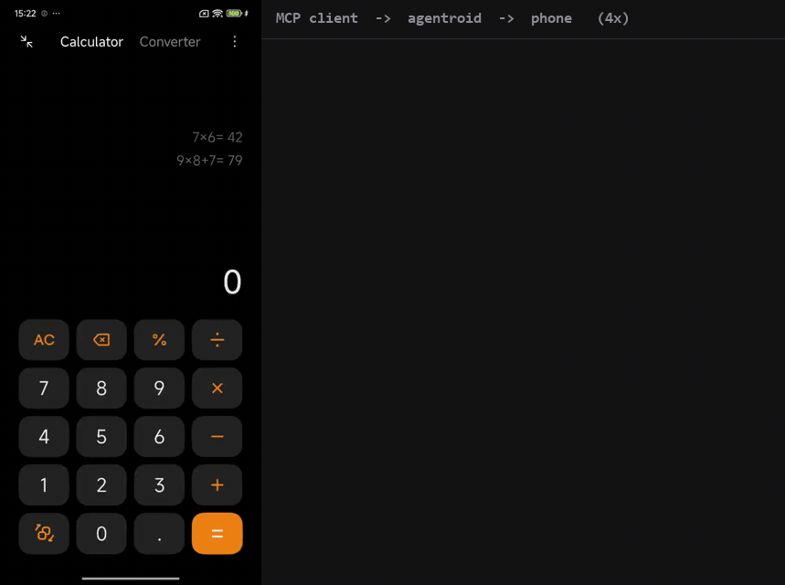
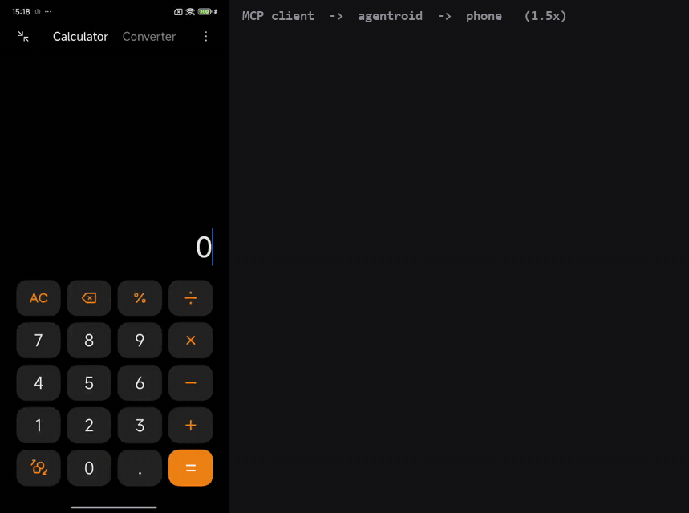
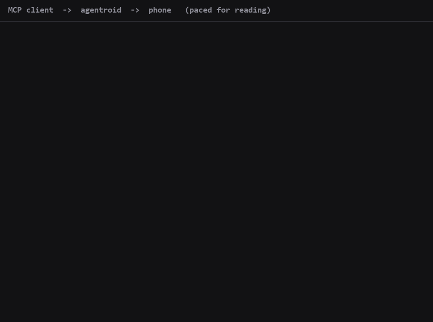

<picture>
  <source media="(prefers-color-scheme: dark)" srcset="docs/media/banner-dark.svg">
  
</picture>

# Agentroid

**An AI agent drives your real Android phone, and each look at the screen costs it [9 to 50 times fewer tokens](#what-one-look-costs) than Android's raw screen text.**

Agentroid is an MCP server (MCP is the plug-in standard AI agents use for tools). It lets an agent such as Claude Code see the screen, tap, type, swipe and open apps on a phone you own. It hands the agent a short text list in place of a screenshot or Android's raw screen description, so a long task fits before the AI runs out of room.

[](LICENSE)
[](#status-and-limits)
[](#how-it-works)
[](#quick-start)
[](#works-on)

[Quick start](#quick-start) · [What one look costs](#what-one-look-costs) · [Works on](#works-on) · [How it works](#how-it-works) · [Safety](#safety) · [Docs](#docs)

<!-- DEMO SLOT. When docs/media/demo-poco.gif exists, point this image at it and rewrite the alt text and the caption below to match that recording. -->
<p align="center">
  
</p>

<p align="center"><sub>Real recording, POCO X6 Pro: one call, six taps; 49 s on the phone, shown at 4×. A script sent the calls, not Claude Code.</sub></p>

## What one look costs

An AI pays for everything it reads, in tokens, and everything it reads stays in its memory for the rest of the task. So the size of one look at the screen decides both the bill and how many steps fit.

<picture>
  <source media="(prefers-color-scheme: dark)" srcset="docs/media/tokens-dark.svg">
  
</picture>

| What the AI is shown | Tokens | Looks that fit in 200,000 tokens | 1,000 looks cost |
| --- | ---: | ---: | ---: |
| Android's raw screen description (`uiautomator dump`, the XML Android hands any app that asks what is on screen) | 11,565 | 17 | USD 46.26 |
| A screenshot of the phone (1220×2712 PNG) | 3,867 | 51 | USD 15.47 |
| **Agentroid, the full list** (every element; tappable ones get a short id) | **1,241** | **161** | **USD 4.96** |
| **Agentroid, the short answer** (the default) | **229** | **873** | **USD 0.92** |
| **Agentroid, "what changed?"** when nothing had | **35** | a follow-up, not a first look | |

- **Measured:** the token column. The home screen of a Xiaomi POCO X6 Pro as recorded on 20 Oct 2026 (the screenshot row is the same phone's home screen on 14 Nov 2026), counted on 14 Nov 2026 with Anthropic's token counter for Claude Opus 5.5. The raw counts and how to repeat them: [docs/media/src/token-counts.json](docs/media/src/token-counts.json).
- **Arithmetic from those counts:** about 50× (11,565 ÷ 229) and about 9× (11,565 ÷ 1,241), the looks that fit (200,000 ÷ tokens, rounded down) and the cost (USD 4 per million input tokens, the Claude Opus 5.5 list price).
- **The catch:** these are sizes of one screen, not a benchmark of whole tasks. On this screen the short answer holds only the clock widget, so an AI looking for an app icon asks for the full list: 1,241 tokens, still about 9× smaller than the raw description. A task benchmark on AndroidWorld is in progress: [docs/BENCHMARK.md](docs/BENCHMARK.md).

<details>
<summary>See the actual text the AI gets for that screen</summary>

<br>

The text below is what Agentroid's own code produces from [the recorded screen](crates/core/tests/redteam/recorded/poco-launcher-2026-10-20.xml). To fit side by side, long lines are wrapped at 40 characters.

<table>
<tr>
<th width="50%">Agentroid's short answer: 453 characters, 229 tokens</th>
<th width="50%">Android's raw description: 30,910 characters, 11,565 tokens</th>
</tr>
<tr>
<td valign="top">

```text
[0] ScreenView "Clock / 1:07 / Tuesday, 
  20 Oct" [label from child] id=workspac
  e scrollable @(610,1332) rccbccd
[1] FrameLayout "Clock" clickable,long-c
  lickable @(610,476) r2bb170
[2] FrameLayout "1:07 / Tuesday, 20 Oct 
  / No data" [label from child] clickabl
  e @(610,476) r37be77
[3] View "1:07 / Tuesday, 20 Oct / No da
  ta" [label from child] clickable @(610
  ,476) r941e62
[4] View "1:07" @(324,275)
[5]
[cut: 2150 more characters; ask for leve
  l "default"]
```

</td>
<td valign="top">

```text
<?xml version='1.0' encoding='UTF-8' sta
ndalone='yes' ?><hierarchy rotation="0">
<node index="0" text="" resource-id="" c
lass="android.widget.FrameLayout" packag
e="com.mi.android.globallauncher" conten
t-desc="" checkable="false" checked="fal
se" clickable="false" enabled="true" foc
usable="false" focused="false" scrollabl
e="false" long-clickable="false" passwor
d="false" selected="false" bounds="[0,0]
[1220,2712]"><node index="0" text="" res
ource-id="" class="android.widget.Linear
Layout" package="com.mi.android.globalla
uncher" content-desc="" checkable="false
… 30,910 characters in all, on one line
```

</td>
</tr>
</table>

The full list of the same screen (2,550 characters, 1,241 tokens). Each line is one thing on the screen; a line that can be tapped ends in a short id such as `r352116`:

```text
[0] ScreenView "Clock / 1:07 / Tuesday, 20 Oct" [label from child] id=workspace scrollable @(610,1332) rccbccd
[1] FrameLayout "Clock" clickable,long-clickable @(610,476) r2bb170
[2] FrameLayout "1:07 / Tuesday, 20 Oct / No data" [label from child] clickable @(610,476) r37be77
[3] View "1:07 / Tuesday, 20 Oct / No data" [label from child] clickable @(610,476) r941e62
[4] View "1:07" @(324,275)
[5] View "Tuesday, 20 Oct" @(344,395)
[6] View "No data" @(946,335)
[7] RelativeLayout "Search / Google Search / Google app" [label from child] long-clickable @(610,1191) r2645e5
[8] AppWidgetHostView "Search" @(610,1166)
[9] FrameLayout "googleapp_search_widget_ghost_google_logo" clickable @(163,1166) re1ea72
[10] FrameLayout "googleapp_search_widget_ghost_text_search" clickable @(538,1166) rc125ac
[11] FrameLayout "googleapp_search_widget_ghost_voice_search" clickable @(913,1166) ra06a82
[12] FrameLayout "googleapp_search_widget_ghost_lens" clickable @(1057,1166) re6519e
[13] ImageView "Google Search" id=googleapp_search_widget_background clickable @(610,1166) r0dc6ef
[14] ImageButton "Google app" id=googleapp_search_widget_google_logo clickable @(163,1166) ra75aca
[15] ImageButton "Voice search" id=googleapp_search_widget_voice_btn clickable @(913,1166) r51c012
[16] ImageButton "Camera search" id=googleapp_search_widget_lens_btn clickable @(1057,1166) r7dc530
[17] TextView "Gallery" clickable,long-clickable @(181,1477) r1f043e
[18] RelativeLayout "Google" clickable,long-clickable @(467,1477) r33578d
[19] ImageView "Google" id=icon_icon @(467,1447)
[20] TextView "Google" id=icon_title @(467,1583)
[21] TextView "Play Store" clickable,long-clickable @(753,1477) rd47592
[22] TextView "Themes" clickable,long-clickable @(1039,1477) rda65b2
[23] TextView "Security" desc="1 unread from Security" clickable,long-clickable @(181,1763) r557e2b
[24] TextView "Settings" desc="1 unread from Settings" clickable,long-clickable @(467,1763) r352116
[25] TextView "Cleaner" clickable,long-clickable @(753,1763) r653a51
[26] SeekBar "Page 1. Total pages: 2" scrollable @(610,2260) rff2766
[27] ImageView "Open App drawer" clickable @(610,2260) r2b26e6
[28] ScreenView "Phone / Messages / Chrome" [label from child] id=hotseat_content_screen scrollable @(610,2472) r25bfbd
[29] TextView "Phone" clickable,long-clickable @(181,2472) rf642c8
[30] TextView "Messages" clickable,long-clickable @(467,2472) rd7243f
[31] TextView "Chrome" clickable,long-clickable @(753,2472) r9ff1f0
[32] TextView "Camera" clickable,long-clickable @(1039,2472) r22466f
```

Print the three texts and their character counts yourself:

```powershell
cargo run -p agentroid-core --example readme_tree_sizes
```

</details>

## Works on

| | Tested with | What happened |
| --- | --- | --- |
| **Real phone** | Xiaomi POCO X6 Pro, Android 15 (HyperOS 2.0) | Driven end to end, regularly, over wireless adb. The recordings on this page are this phone. |
| **Real phone** | Samsung Galaxy S24 Ultra (SM-S928B), Android 17 | Connected and read. Kept read-only on purpose: it is the owner's personal phone, so his build hard-codes it as a protected device that answers reads only. |
| **Emulator** | Android 13 emulator | Works. |
| **AI agent** | Claude Code | The only MCP client tried so far. |

A phone is never driven until you name it. You allow each phone by its serial number, and emulators with a separate switch.

## Quick start

**You need** Windows 11 (**Windows only for now**; Windows 10 should work but has not been tried), [adb](https://developer.android.com/tools/releases/platform-tools) (Android's debugging bridge, part of Android's platform-tools), a recent stable [Rust](https://rustup.rs) with the Visual Studio C++ Build Tools, [Node.js](https://nodejs.org) 22.6 or later, and [Claude Code](https://claude.com/claude-code). Run everything below in PowerShell.

**1. Get the code and build it**

```powershell
git clone https://github.com/Sohwhat6420/agentroid-mcp.git
```

```powershell
cd agentroid-mcp
```

```powershell
cargo build --release --workspace
```

The first build compiles every dependency, so it is the slow step. Keep this PowerShell window open: steps 2 to 4 use it.

**2. Connect your phone and read its serial number**

Turn on USB debugging in the phone's Developer options, plug it in (or connect over wireless debugging) and accept the prompt on the phone.

```powershell
adb devices -l
```

```powershell
$serial = (adb shell getprop ro.serialno).Trim()
```

With several devices connected, disconnect the others for this step.

**3. Start Agentroid for that phone**

```powershell
.\target\release\bridged.exe --adb auto --allow-serial $serial
```

The daemon has no window, so the command returns at once. Read the last line of its log:

```powershell
Get-Content "$env:LOCALAPPDATA\agentroid\bridged.log" -Tail 1
```

It should say:

```text
bridged 0.1.0 listening on \\.\pipe\agentroid
```

If no new `listening on` line appears, open "when it does not start" under step 5.

**4. Add it to Claude Code**

```powershell
cd apps\mcp
```

```powershell
npm ci
```

```powershell
claude mcp add --scope user agentroid -- node --experimental-strip-types "$PWD\src\sdk-wiring.ts"
```

Check that Claude Code can reach it. The list should show `agentroid` as connected:

```powershell
claude mcp list
```

**5. Ask your agent**

```text
Use Agentroid to list the connected devices, look at the screen and tell me what is on it.
```

<details>
<summary>Using an emulator, a smaller tool list, other MCP clients, stopping it, and when it does not start</summary>

<br>

**An emulator instead of a phone.** Start the emulator, then start the daemon with the emulator switch:

```powershell
.\target\release\bridged.exe --adb auto --allow-emulators
```

**A smaller tool list.** The AI loads the tool list once at the start: all 27 tools cost 4,635 tokens. The `minimal` profile keeps 8 of them for 1,331 tokens. Use this line in place of the one in step 4:

```powershell
claude mcp add --scope user agentroid -e AGENTROID_PROFILE=minimal -- node --experimental-strip-types "$PWD\src\sdk-wiring.ts"
```

**Other MCP clients (not tried yet).** Claude Code is the only client tested. A client that reads the usual `mcpServers` JSON should take this entry, with the path changed to where you cloned the repository:

```json
{
  "mcpServers": {
    "agentroid": {
      "command": "node",
      "args": ["--experimental-strip-types", "C:\\code\\agentroid-mcp\\apps\\mcp\\src\\sdk-wiring.ts"]
    }
  }
}
```

**Stop the daemon** (from the repository root):

```powershell
.\target\release\bridged.exe --stop
```

**If it does not start.** The daemon has no console, so a mistyped switch makes it exit at once and leaves nothing in the log. If no new `listening on` line appears, check each switch against the list at the top of [`crates/bridged/src/main.rs`](crates/bridged/src/main.rs). The log shows what earlier starts wrote:

```powershell
Get-Content "$env:LOCALAPPDATA\agentroid\bridged.log" -Tail 20
```

Full requirements, wireless debugging notes and troubleshooting: [docs/REFERENCE.md](docs/REFERENCE.md#setup-notes).

</details>

## How it works

<picture>
  <source media="(prefers-color-scheme: dark)" srcset="docs/media/how-dark.svg">
  
</picture>

Agentroid is an MCP server (MCP is the plug-in standard AI agents such as Claude Code use for tools) plus a small daemon on your PC that talks to the phone over adb. Your agent stays the brain. Agentroid is its eyes and hands, and it keeps what the agent reads small in five ways:

- **A short answer first.** A look returns the first 400 characters of the screen list and a one-line note on how to ask for more (the `digest` level). The agent pays for detail only when it needs it.
- **"What changed?" instead of a second look.** After the first look the agent can ask only for the lines that were added, changed or removed (`since=`). When nothing changed, that answer is 35 tokens.
- **Names that survive a scroll.** Each tappable thing gets a short id such as `r352116` that stays the same when the screen scrolls or re-lays out (a stable ref), so the agent does not have to look again to find it.
- **Several steps in one call.** A list of steps runs on your PC as one job (`job_start`). The recording at the top is six taps for one call and one reply.
- **No AI inside.** Agentroid makes 0 model calls and needs no API key of its own. Every reply carries a receipt that says so.

<details>
<summary>One more recording: look, tap four times, look again</summary>

<br>

<p align="center">
  
</p>

<p align="center"><sub>Played at 1.5× speed. A short script sent the calls, not Claude Code.</sub></p>

</details>

## Safety

An agent with a phone in its hands needs limits that it cannot talk its way past, so the checks live in the daemon and not in a prompt. Nothing is driven unless you allowed that phone by serial number. Every action is checked against what is on the screen at that moment: payments, banking apps, factory resets and typing into password or one-time-code fields are refused, and sending, deleting, installing and permission dialogs are refused unless you approve them from another device (an optional approval channel). There is no free shell: the only shell commands that run are read-only diagnostics from a fixed list, and anything else is refused. Every decision goes into a hash-chained log, which shows if anyone edits it afterwards. The guard is plain rules, so it has blind spots: what it catches, what it misses and the red-team results are published in [docs/SAFETY.md](docs/SAFETY.md). Use it on phones you own or are allowed to test.

<p align="center">
  
</p>

<p align="center"><sub>A read-only check runs; two commands that would change the phone are refused before they reach it. Paced for reading.</sub></p>

## Status and limits

Agentroid is a preview (0.1.0). It works and is tested, but it is not 1.0.

- **Windows only** for the daemon in this build, tested on Windows 11. A Linux listener is written but not built or tested.
- **Build it from source.** Nothing is published to crates.io or npm yet.
- **Every allowed phone gets full access.** Per-device modes (read-only, helper) exist in the daemon but cannot be set from configuration yet.
- **Text, not pictures.** The agent reads the screen as a text list. `screenshot` and `look` do not send image bytes to the agent in this build.
- **Not implemented yet:** `pixel_probe`, and `look`'s `element` and `ocr` options. `set_value` sets text fields only.
- **One AI client tried:** Claude Code.
- **No task benchmark yet.** The AndroidWorld runs so far are in [docs/BENCHMARK.md](docs/BENCHMARK.md).

## How it was built

[Ethan Soh](https://github.com/Sohwhat6420) directs the design and testing; AI coding agents wrote most of the code under his direction.

## Docs

- [docs/REFERENCE.md](docs/REFERENCE.md): every feature, the full setup notes and troubleshooting.
- [docs/SAFETY.md](docs/SAFETY.md): how the screen guard decides, and its published red-team results.
- [docs/BENCHMARK.md](docs/BENCHMARK.md): the AndroidWorld runs so far.
- [docs/CONNECTION-KEEPER.md](docs/CONNECTION-KEEPER.md): the Android module that brings wireless adb back after a Wi-Fi drop or a reboot.
- [docs/media/src](docs/media/src): the scripts that draw the pictures on this page from the measured figures, and the raw token counts. The banner's phone body and desk are a generated picture; the screen in it is a real screenshot.
- [CONTRIBUTING.md](CONTRIBUTING.md) and [SECURITY.md](SECURITY.md).

## Licence

Apache License 2.0. See [LICENSE](LICENSE) and [NOTICE](NOTICE). Android is a trade mark of Google LLC; this project is not affiliated with Google.
