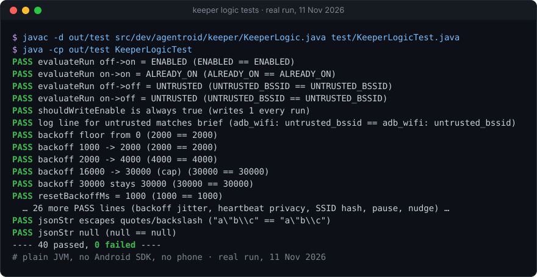

# Agentroid keeper (standalone)

[](https://github.com/Sohwhat6420/agentroid-mcp/actions/workflows/ci.yml)


**A 25 KB Android app that keeps Wireless debugging (`adb` over Wi-Fi) switched on**, so a phone you drive from a laptop doesn't silently drop off after a Wi-Fi change, a reboot or a crash. No UI, no dependencies, no listening socket.

**Why it's interesting:** Android switches Wireless debugging off whenever the phone leaves Wi-Fi or restarts, and normally a human has to walk over and flip the tile again. The keeper holds `WRITE_SECURE_SETTINGS` (granted once over adb) and turns it back on by itself, even **before the first unlock** after a reboot. Measured on a POCO X6 Pro: adb back **6–13 s** after Wi-Fi returned with no tap, and held for about **30 h** unattended.

<p align="center"></p>

```bash
./build.sh                    # 25 KB APK, no Gradle (JDK 17 + Android SDK)
./setup-keeper.sh <SERIAL>    # install, grant WRITE_SECURE_SETTINGS, start; SERIAL from `adb devices`
mkdir -p out/test && javac -d out/test src/dev/agentroid/keeper/KeeperLogic.java test/KeeperLogicTest.java && java -cp out/test KeeperLogicTest   # tests, no phone
```

It is one piece of **Agentroid** (the rest of this repository), my project for letting an AI agent drive Android phones over adb. This folder is the standalone build; the same job also lives as the `android/keeper` module of the one-app Agentroid build. Run the commands above from this folder (`apps/keeper`). This folder is MIT-licensed (its own `LICENSE`); the rest of the repository is Apache-2.0. The keeper stands alone and is useful to anyone who leaves a phone on the desk and talks to it over adb.

## The problem

Android turns Wireless debugging off whenever the phone leaves a Wi-Fi network, restarts, or the adb daemon is recycled. For a phone that is meant to be driven from a laptop, that means a human has to walk over, wake the screen and flip the Developer-options tile again, every time. On the POCO X6 Pro I built this on (HyperOS 2, Android 15) it happened several times a day.

## How it works

A foreground service (`connectedDevice`, minimum-importance notification) holds `WRITE_SECURE_SETTINGS`, granted once over adb, and does one job: write `Settings.Global.adb_wifi_enabled = 1` and check that it stuck.

It runs that loop on four triggers:

| Trigger | Why |
| --- | --- |
| The default network becomes available | Wi-Fi came back, adb needs re-enabling |
| `adb_wifi_enabled` changes (a `ContentObserver`) | Something switched it off; switch it back |
| Boot, including `LOCKED_BOOT_COMPLETED` | Works before the first unlock (direct-boot-aware storage) |
| An exact alarm every ~15 minutes | Backstop if the service was killed; re-arms itself |

After each write it samples the setting for up to 5 s. If it reads `0` again, Android refused (see Limits) and the keeper logs `adb_wifi: untrusted_bssid` rather than pretending it worked.

Extras:

- **Port discovery.** `NsdManager` looks up `_adb-tls-connect._tcp` so the current Wireless-debugging port is known.
- **Network-gone nudge.** If the network disappears, a partial wake lock holds the CPU and the screen is woken briefly (15 s, then every 45 s, up to 12 times) because some builds rejoin Wi-Fi far faster with the screen on. *Installed but not yet proven in a real outage; see Limits.*
- **Timed pause.** `--es pause 1` pauses the keeper for 2 h (`--es pause_min N`, max 12 h); `--es pause 0` resumes. Handy while you change Wi-Fi on purpose.
- **Optional heartbeat.** If you give it a hub URL it POSTs a small JSON heartbeat (`serial_hint`, `port`, `adb_wifi_enabled`, a salted SSID hash, battery, timestamp) every 60 s. With no hub it sends nothing. If the hub is down it logs one short line and carries on; nothing about the keeper's job depends on it.

The decision logic lives in `KeeperLogic.java` with no Android imports, so it is unit-tested on a plain JVM.

## Quick start

You need a phone with Developer options on and adb access once (USB or an existing Wireless-debugging pairing), JDK 17, and the Android SDK with `platforms;android-36` and `build-tools;36.0.0`.

```bash
# 1. Build (no Gradle). The first build makes a signing key in ~/.keys, outside this repo.
./build.sh

# 2. Install and arm it on one phone. SERIAL is exactly what `adb devices` prints.
./setup-keeper.sh <SERIAL>
#    with a heartbeat hub:     ./setup-keeper.sh <SERIAL> http://192.0.2.10:8765/keeper/heartbeat
#    never touch this phone:   KEEPER_REFUSE_SERIALS="<hardware serial>" ./setup-keeper.sh <SERIAL>

# 3. On Xiaomi/HyperOS, set the app's battery mode to "No restrictions" once.
```

Remove it with `adb -s <SERIAL> uninstall dev.agentroid.keeper`.

Run the tests:

```bash
mkdir -p out/test && javac -d out/test src/dev/agentroid/keeper/KeeperLogic.java test/KeeperLogicTest.java && java -cp out/test KeeperLogicTest
```

## Measured

All on one POCO X6 Pro (HyperOS 2, Android 15), 29 Oct to 2 Nov 2026, driven only over Wi-Fi adb.

| Test | Result |
| --- | --- |
| Logic unit tests (`KeeperLogicTest`) | 40 / 40 pass (re-run on the published code) |
| APK size | 24,975 bytes, signed, minSdk 29 / targetSdk 36 |
| Wi-Fi drop, known network (K2, round 2) | Wireless debugging re-enabled **6 s** after the network returned, no tap |
| Wi-Fi drop, 18 min outage (K2, round 3) | Re-enabled within **8 s** of each return, two outages (1,148 s and 240 s), no tap |
| Wi-Fi drop, screen off, unplugged, three rounds (1 Nov) | adb back at **+12 s, +12 s, +13 s**, no tap |
| `am crash` of the service (K3) | Back in about 15 min through its alarm (the alarm fires every ~20 min under Doze) |
| Cold boot behind the lock screen (K4, an accidental pass) | `adb_wifi_enabled` set **5 s** after `LOCKED_BOOT_COMPLETED`, before first unlock; adb reconnected on the laptop's next scan, no tap |
| Longest hold | Kept adb up for about **30 h** (1 Nov 14:08 to 2 Nov 20:00); every later drop traced to the battery dying, slow Wi-Fi rejoin, or a new access point |

Not a benchmark; one phone, small numbers. The raw log lines are in the commit history ([docs/HISTORY.md](docs/HISTORY.md)).

## Limits

- **A new access point needs one human tap.** Android only auto-enables Wireless debugging on Wi-Fi networks (BSSIDs) you have approved with "Always allow". On a new or roamed BSSID the write is reverted and the keeper can only log `untrusted_bssid`. In my runs this cost one outage of about 36 hours until I tapped. Without root there is no fix.
- **Needs adb once.** `WRITE_SECURE_SETTINGS` can only be granted over adb (`pm grant`), so the first install needs a connection.
- **Slow Wi-Fi rejoin is not the keeper's to fix.** In my first rounds the phone took 4 to 30 minutes to come back after a `svc wifi` drop with the screen off. The cause turned out to be the drop script itself (a shell `sleep` freezes while the phone is suspended), not the phone, but the stall is intermittent: three clean rounds afterwards recovered in 12, 12 and 13 s. A real outage (router or access point gone) has not been timed.
- **The wake-up nudge is unproven.** In the last test the network was back in 11 s so the nudge never fired. It is there, tested only as logic.
- **Tested on one phone.** The Autostart app-ops (`10007`, `10008` and friends) are HyperOS/MIUI specific and harmless elsewhere; everything else is stock Android 11+ API, but I have not run it on anything but the POCO.
- **Cleartext heartbeat.** The hub URL is `http://` by design (a LAN or VPN hub). It carries no token and no raw SSID, but do not point it at the open internet.

## Roadmap

- Try it on a Pixel and a Samsung and publish what changes.
- Prove the nudge in a real router-side outage.
- A tiny reference hub (`/keeper/heartbeat` receiver plus an alert when a phone has been quiet for N minutes).
- Optional HTTPS for the heartbeat.
- A one-tap in-app "I changed Wi-Fi on purpose" pause.

## History

The code here was extracted from the monorepo it grew in. Device serials, a LAN address and build output were scrubbed. [docs/HISTORY.md](docs/HISTORY.md) has the timeline.

## Licence

MIT, see `LICENSE`. Feedback, results from other phones and bug reports are all welcome: open an issue or start a Discussion ([CONTRIBUTING.md](CONTRIBUTING.md)).
